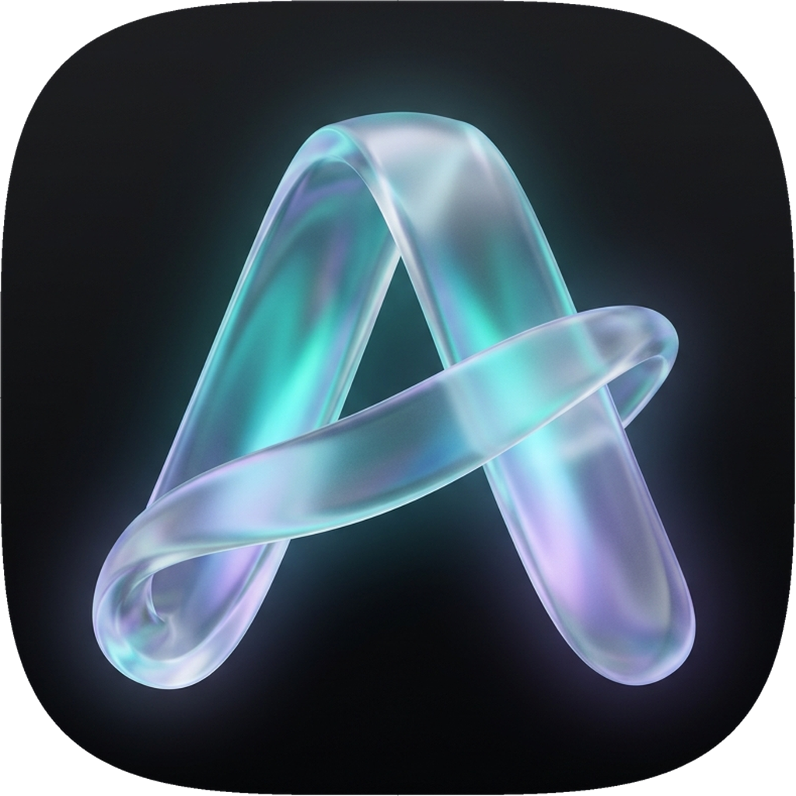

# Aura Desktop

**Next-Generation Lossless Music Player with Algorithmic Smart Playlists, Real-Time Synced Lyrics, Cross-Device Continuity & Last.fm Scrobbling.**

  
  
  
  

---

## Overview

Aura Desktop is an audiophile-grade desktop music player engineered for seamless playback and complete ecosystem continuity. Connect with your YouTube Music or Spotify account, enjoy true bit-perfect lossless playback via WASAPI / libmpv, view live synchronized karaoke lyrics, and control music playing on any phone, Bluetooth speaker, or amplifier on your local network using **Aura Connect**.

---

## Key Features

- **Aura Connect (Seamless Device Continuity)**: Control playback from your PC when your phone is plugged in across the room or paired to a Bluetooth speaker. Live timeline sync, output route reporting ("Bluetooth: Speaker", "Phone speaker"), and bidirectional transport control.
- **Pure Lossless & Hi-Res Playback**: Direct stream resolution and local caching backed by high-performance WASAPI and libmpv engines.
- **Synced Karaoke & Word-by-Word Lyrics**: High-precision scrolling lyrics with translation, romanization, and synchronized timing.
- **YouTube Music & Spotify Integration**: One-click Google sign-in and direct web integration for personal libraries, Liked Songs, mixes, and artist discographies.
- **Last.fm Scrobbling**: Automatic scrobbler with offline queueing, real-time now-playing notifications, and personal taste radar.
- **Fluent & Acrylic Glass Interface**: Responsive WinUI 3 inspired design with ambient album art glow, customizable themes, and keyboard shortcuts.
- **Automix & Smart Queuing**: Intelligent harmonic mixing, beat transitions, and algorithmic recommendation engine.

---

## Installation

### Windows (10 / 11)
- **Installer (Recommended)**: Download `aura_<version>_windows-x86_64-setup.exe` from [Releases](https://github.com/aniketdubey1204-code/Aura-Desktop/releases). Run the setup to install with Start Menu shortcuts and SMTC media flyout integration.
- **Portable**: Download `aura_<version>_windows-x86_64-portable.zip`, extract to any folder, and run `aura_desktop.exe`.

### Linux
- **AppImage (Universal)**: Download `aura_<version>_x86_64.AppImage`, make it executable (`chmod +x`), and launch.
- **Debian / Ubuntu**: `sudo dpkg -i aura_<version>_amd64.deb`
- **Fedora / RHEL**: `sudo rpm -i aura_<version>_x86_64.rpm`

### macOS
- Download `aura_<version>_macos-arm64.zip` from [Releases](https://github.com/aniketdubey1204-code/Aura-Desktop/releases) and extract `Aura.app`.

---

## License

Proprietary — All Rights Reserved.
